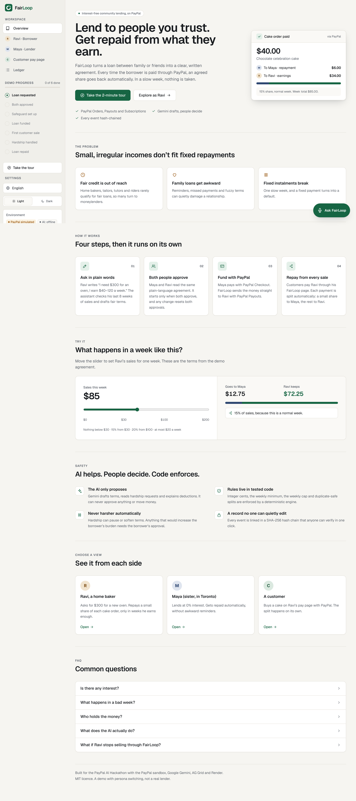
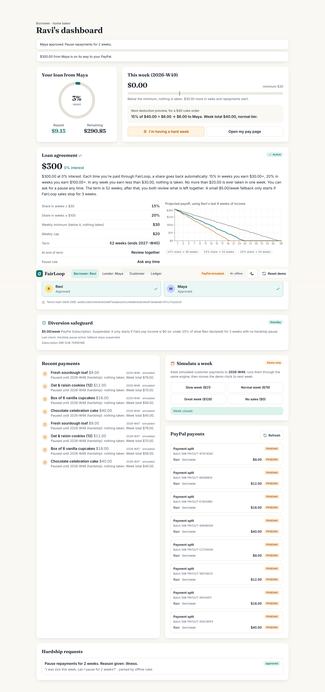
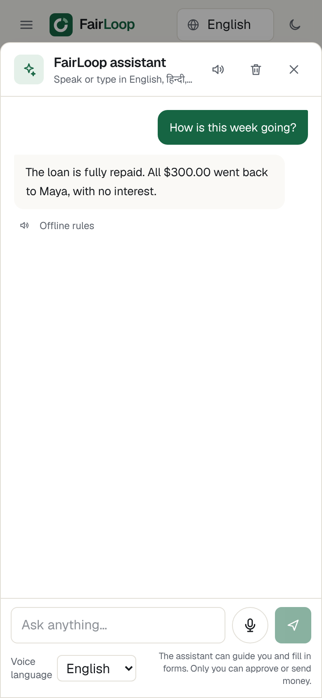
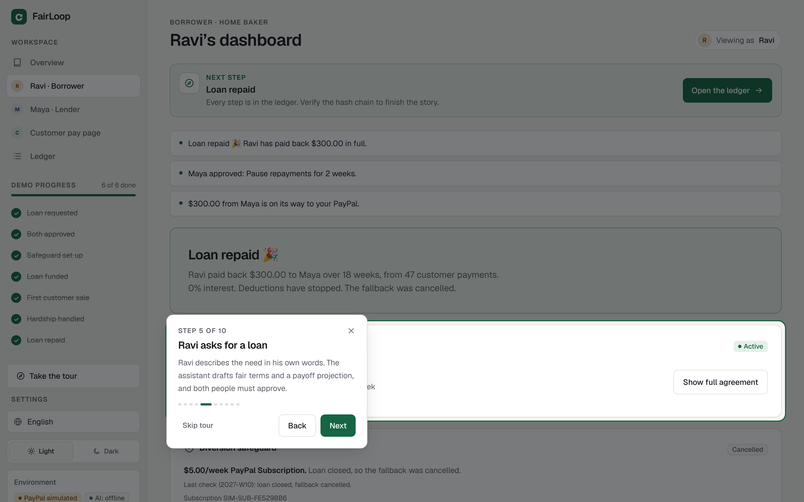
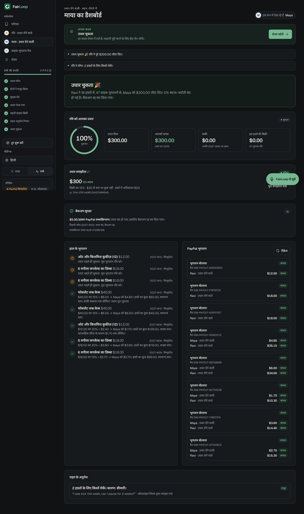
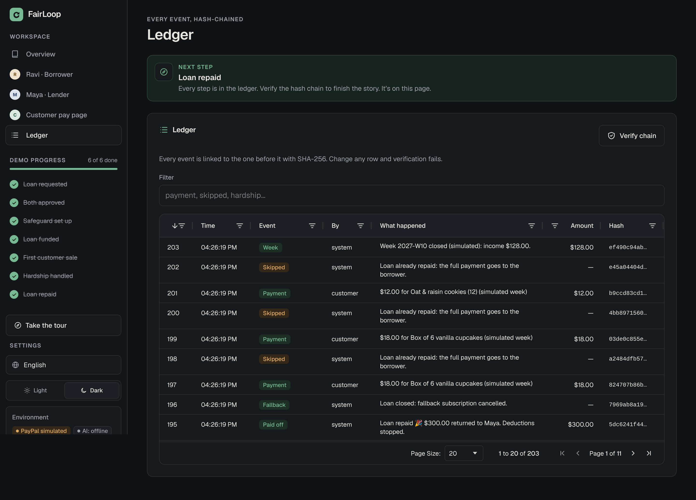
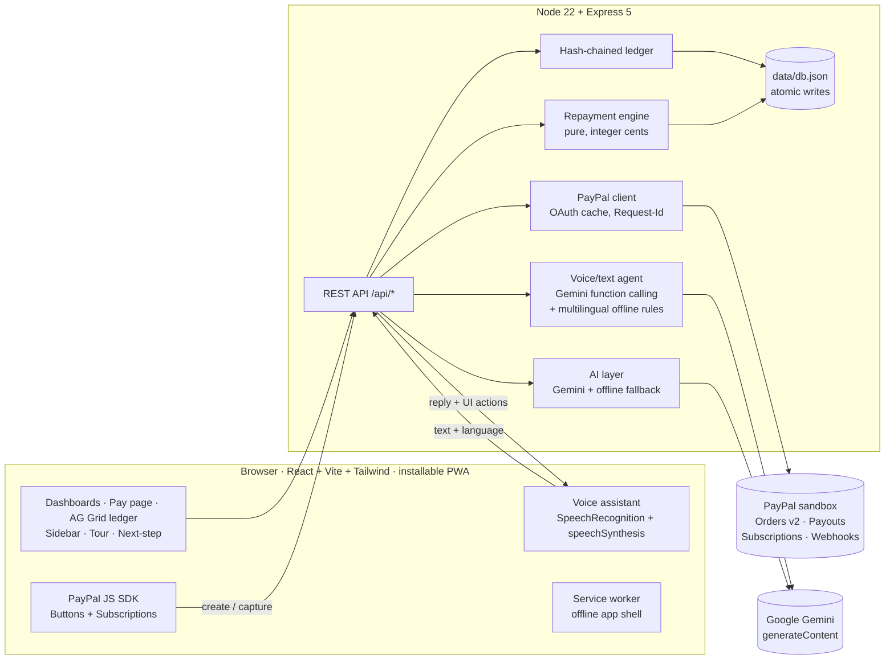

<p align="center">
  <picture>
    <source media="(prefers-color-scheme: dark)" srcset="docs/brand/fairloop-logo-dark.png">
    
  </picture>
</p>

<h1 align="center">FairLoop</h1>

<p align="center"><strong>Interest-free loans between people who trust each other, repaid automatically from what the borrower earns, through PayPal.</strong></p>



> Built for the **PayPal AI Hackathon**. This is a working demo with **persona switching** (Maya the lender, Ravi the borrower, and a customer) instead of real accounts. It runs with **zero keys** in simulated mode, and against the **real PayPal sandbox and Google Gemini** when you add keys.

**Contents:** [Features](#features-at-a-glance) · [Screenshots](#screenshots) · [Try it in 2 minutes](#try-it-in-2-minutes) · [Demo flow](#demo-flow) · [Quick start](#quick-start) · [Sandbox setup](#paypal-sandbox-setup) · [Environment](#environment-variables) · [Deploy](#deploy-to-render) · [Architecture](#architecture) · [API](#api) · [PayPal](#how-paypal-is-used) · [AI](#how-ai-is-used) · [Voice assistant](#voice-assistant) · [Safety](#safety-where-the-line-is-drawn) · [Tests](#tests) · [Limitations](#limitations)

---

## The problem

People with small, irregular incomes (home bakers, tailors, tutors, delivery riders, freelancers) can't get fair credit. They go to moneylenders, or they borrow from family and friends, and that often damages the relationship: awkward reminders, missed payments, unclear terms. Fixed weekly payments don't fit irregular income either. One bad week and they default.

## The solution

A lender (a family member, friend, community group or seller platform) and a borrower agree on a loan and a repayment rule tied to income. The borrower's customers pay through FairLoop's PayPal checkout. Each time the borrower earns, an agreed share goes back to the lender automatically, until the loan is repaid. In a slow week, nothing is taken.

- **0% interest.** These are community and family loans. Commercial lending would need a licence (see [What's next](#whats-next)).
- **AI helps, people decide, code enforces.** Gemini drafts a plain-language agreement, checks affordability against real income, turns hardship messages into clear requests, explains every deduction and answers questions by voice. A deterministic, unit-tested engine decides every cent. The AI never moves money.
- **USD only.** PayPal doesn't support domestic payments within India, so the demo uses international personas.

## Features at a glance

| | |
|---|---|
| 💸 **PayPal money rails** | Orders v2 checkout for funding and sales, Payouts to split every payment, Subscriptions as a diversion safeguard, verified webhooks |
| 🧮 **Repayment engine** | A share of sales, set by how much was earned that week, plus a weekly minimum and a weekly cap. Pause, review and end-of-term rules. Integer cents. Duplicate payments are never processed twice |
| 🤖 **Gemini AI** | Function calling and structured JSON: affordability check, agreement drafting, hardship parsing, explanations, review options |
| 🎙️ **Voice assistant** | Speak in English, Hindi, French or Spanish. It answers from live data in your language, reads the answer aloud, opens pages and fills in forms for you |
| 🌍 **Four languages** | English, हिन्दी, Français and Español, covering the whole interface, agreements, explanations and notifications |
| 🧭 **Guided UX** | An explainer homepage with an interactive calculator, an 11-step spotlight tour, a live demo-progress checklist and a "Next step" card on every dashboard |
| 📱 **Mobile and PWA** | Mobile-first layout, bottom tabs, bottom sheets, installable app with home-screen shortcuts and an offline shell |
| 🔐 **Tamper evidence** | An AG Grid ledger with a SHA-256 hash chain and one-click verification |

## Screenshots

| Ravi's dashboard | Voice assistant (phone) | Guided tour |
|---|---|---|
|  |  |  |
| **Agreement + payoff projection** | **Maya's dashboard in Hindi (dark)** | **Hash-chained ledger (AG Grid)** |
|  |  |  |

More, at phone and desktop sizes in light and dark mode and in every language, are in [`docs/screenshots/`](docs/screenshots/). A 15-image, 3:2 presentation gallery (used on Devpost) is in [`docs/gallery/`](docs/gallery/), generated from the live app by `npm run gallery`.

## Try it in 2 minutes

1. Run `npm install && npm start`, then open http://localhost:3000. No keys are needed.
2. Click **Take the 2-minute tour**, or press the green **Ask FairLoop** button and say *"What should I do next?"*.
3. Follow the **Next step** card. The sidebar checklist ticks itself off as you go: request → approve → safeguard → fund → first sale → hardship → repaid.

## Demo flow

1. **Ravi asks for a loan** in plain language, typed or spoken: *"I need $300 for a new oven, I earn about $40–120 a week from cake orders."* If the amount is missing, the AI asks one follow-up question.
2. **The AI drafts the agreement:** the amount, a share that depends on how much Ravi earns that week, a weekly minimum, a weekly cap, a pause rule, the term and what happens at the end. A chart projects payoff from Ravi's 8-week income history. If payoff would take more than 52 weeks, it warns and suggests a smaller amount.
3. **Both people approve.** The agreement is active only once both approve the same terms. Either person can propose a change, and any change resets both approvals. A SHA-256 hash of the terms is stored with each approval.
4. **Diversion safeguard.** Ravi approves a small PayPal Subscription ($5 a week by default), which FairLoop immediately suspends (see below).
5. **Maya funds the loan** with PayPal Buttons (Orders v2: create, approve, then capture on the server). FairLoop disburses to Ravi with **PayPal Payouts**.
6. **A customer buys a cake** on `/pay/ravi`. After capture, the engine splits the payment into **one payout batch with two items**: Maya's share (`<capture>-LENDER`) and Ravi's remainder (`<capture>-BORROWER`).
7. **Low-income week.** "Simulate a week" (demo only, clearly labelled) adds small payments. Below the minimum, nothing is taken, and the ledger shows *"Skipped: below weekly minimum"*.
8. **Hardship.** Ravi types or says *"I was sick this week, can I pause for 2 weeks?"*, in any of the four languages. The AI turns it into a structured request. Maya approves or declines. Terms can never get harsher automatically.
9. **Paid off.** The last deduction is capped at the remaining balance, deductions stop, the fallback subscription is cancelled, and both dashboards show "Loan repaid 🎉".
10. **Ledger.** The AG Grid ledger lists every event in a SHA-256 hash chain, with a **Verify chain** button.

### Diversion safeguard (fallback subscription)

If Ravi stopped routing sales through FairLoop, Maya would never be repaid. To prevent that:

- At signing, FairLoop creates a plan (`POST /v1/catalogs/products`, then `POST /v1/billing/plans`). Ravi approves it with the JS SDK (`createSubscription`), and FairLoop immediately calls `POST /v1/billing/subscriptions/{id}/suspend`.
- **The engine decides** (`fallbackDecision` in `server/lib/engine.js`). The fallback starts only if FairLoop income is **$0 for 3 consecutive weeks**, or **under 25% of declared weekly income for 3 weeks**, and no hardship pause is active. When it starts, both people get an AI-written check-in message and FairLoop calls `/activate`.
- It suspends again as soon as income returns, and is cancelled on payoff. Weeks covered by a hardship pause never count toward the trigger.

## Quick start

```bash
git clone https://github.com/vineeta07/PaypalAIHackathon.git
```

```bash
cd PaypalAIHackathon
```

```bash
npm install && npm start
```

Open http://localhost:3000. With no keys, the app runs in **simulated mode**: the same engine and API, fake `SIM-` ids, and a visible "PayPal simulated" badge. `npm start` builds the web app first if `dist/` is missing. To rebuild explicitly, run `npm run build && npm start`.

To use the real PayPal sandbox and Gemini, copy `.env.example` to `.env`, fill in the keys, and restart.

### Scripts

| Script | What it does |
|---|---|
| `npm run dev` | API with `--watch` on :3000 plus the Vite dev server on :5173 (proxies `/api`) |
| `npm run build` | Builds the React app (and PWA files) into `dist/` |
| `npm start` | Serves the API and `dist/` (builds first if needed) |
| `npm test` | 38 `node:test` tests: engine, PayPal client, AI, voice agent, i18n, HTTP routes |
| `npm run lint` | TypeScript type-check plus a server syntax check |
| `npm run e2e` | Headless Chromium click-through of the whole demo, tour, assistant, PWA and languages; writes `docs/screenshots/` |
| `npm run brand` | Regenerates the logo, app icons, favicon and social card from `scripts/brand.js` (`npm run icons` is an alias) |

## PayPal sandbox setup

1. Go to https://developer.paypal.com/dashboard/, open **Apps & Credentials** (Sandbox) and create an app. Copy its **Client ID** and **Secret** into `PAYPAL_CLIENT_ID` and `PAYPAL_CLIENT_SECRET`.
2. In the app's settings, **enable Payouts** (under Features). Check that Subscriptions are enabled too.
3. Under **Sandbox → Accounts**, create 3 **personal** accounts: lender, borrower and customer. Put the lender and borrower emails in `.env` as `LENDER_PAYPAL_EMAIL` and `BORROWER_PAYPAL_EMAIL`. Use the lender account in the PayPal popup to fund the loan, and the customer account to buy a cake.
4. Make sure the sandbox **business** account that owns the app has a USD balance, because Payouts are sent from it.
5. Optional: add a webhook to `https://<your-host>/api/paypal/webhook` for `PAYMENT.CAPTURE.COMPLETED` and `PAYMENT.PAYOUTS-ITEM.*`, then set `PAYPAL_WEBHOOK_ID`.

> No test credentials are committed. Judges can run everything in simulated mode with zero keys.

### Gemini API key

1. Go to https://aistudio.google.com and sign in with a Google account.
2. Click **Get API key → Create API key**, and copy it into `GEMINI_API_KEY`.
3. Check which models your key can use (AI Studio's model picker). If `gemini-3.6-flash` isn't listed, set `GEMINI_MODEL` to one that is. If the model call fails, FairLoop falls back to its offline rules, and the sidebar shows **AI: offline**.

### Where the keys go

- **On your computer:** copy `.env.example` to `.env`, paste the values, and restart `npm start`. `.env` is git-ignored; never commit it.
- **On Render:** open **Dashboard → fairloop → Environment**, add the same names and values, and save (it redeploys).

## Environment variables

| Name | Required | Default | Purpose |
|---|---|---|---|
| `PAYPAL_CLIENT_ID` | no | (empty → simulated) | Sandbox REST app client id; also loads the JS SDK |
| `PAYPAL_CLIENT_SECRET` | no | (empty → simulated) | Sandbox REST app secret (server only) |
| `PAYPAL_API_BASE` | no | `https://api-m.sandbox.paypal.com` | PayPal REST base URL |
| `PAYPAL_WEBHOOK_ID` | no | (empty → webhook ignored) | Turns on webhook signature verification |
| `LENDER_PAYPAL_EMAIL` | with keys | `maya.lender@example.com` | Payout receiver for repayments |
| `BORROWER_PAYPAL_EMAIL` | with keys | `ravi.baker@example.com` | Payout receiver for disbursement and earnings |
| `GEMINI_API_KEY` | no | (empty → offline AI) | Google Gemini API key, used by both the AI layer and the voice agent |
| `GEMINI_MODEL` | no | `gemini-3.6-flash` | Gemini model id |
| `PORT` | no | `3000` | HTTP port |
| `DATA_FILE` | no | `data/db.json` | JSON store location |

## Deploy to Render

The repo includes a [`render.yaml`](render.yaml) Blueprint, so Render configures everything for you. A fresh clone builds and starts with exactly these commands.

**One-click:** open https://render.com/deploy?repo=https://github.com/vineeta07/PaypalAIHackathon (you'll be asked to sign in to Render).

**Or step by step:**

1. Sign in at https://dashboard.render.com with GitHub, and allow Render to access this repository.
2. Click **New → Blueprint**, pick `vineeta07/PaypalAIHackathon`, branch `main`.
3. Render reads `render.yaml` and shows one web service, **fairloop** (Node 22, free plan). It asks for the secret values; you can leave them all empty to deploy in **simulated mode**:
   - `PAYPAL_CLIENT_ID`, `PAYPAL_CLIENT_SECRET`: sandbox app keys (turns on the real PayPal sandbox)
   - `LENDER_PAYPAL_EMAIL`, `BORROWER_PAYPAL_EMAIL`: sandbox personal-account emails that receive Payouts
   - `GEMINI_API_KEY`: turns on Gemini for drafting and the voice assistant
   - `PAYPAL_WEBHOOK_ID`: optional, see step 6
4. Click **Apply**. Render runs `npm ci --include=dev && npm run build`, then `npm start`, and waits for `/api/health` to answer.
5. Open your URL, for example `https://fairloop-xxxx.onrender.com`. The sidebar shows **PayPal sandbox** or **PayPal simulated** and **AI: Gemini** or **AI: offline**, so you can confirm which keys are active.
6. Optional: in the PayPal developer dashboard, add a webhook pointing to `https://<your-url>/api/paypal/webhook` (events `PAYMENT.CAPTURE.COMPLETED` and `PAYMENT.PAYOUTS-ITEM.*`), copy its ID into `PAYPAL_WEBHOOK_ID` in Render (**Environment** tab), and save; Render redeploys automatically.

**Good to know**

- Render serves over **HTTPS**, which the microphone (voice assistant) and **Install app** (PWA) both need.
- Every push to `main` redeploys automatically. To change keys later: **Dashboard → fairloop → Environment**.
- **Free plan:** the service sleeps after about 15 minutes idle, and the first visit after that takes 30–60 seconds to wake. Open the URL a minute before judging or recording. The disk is not persistent, so demo data resets on each deploy or restart; the **Reset demo** button reseeds it anytime.
- **Other hosts:** any Node 22 host works with `npm ci --include=dev && npm run build` then `npm start`. The app listens on `PORT`.

## Architecture



```
server/
  index.js            wires env → PayPal (sandbox or simulated), AI, agent, store, app
  app.js              routes + orchestration (settle payment → engine → payout batch → ledger)
  seed.js             personas, products, 8-week income history
  lib/engine.js       repayment rule engine (no I/O, fully unit-tested)
  lib/paypal.js       PayPal REST client + simulated twin with the same interface
  lib/ai.js           Gemini function calling / responseSchema + deterministic fallbacks
  lib/agent.js        voice/text assistant: Gemini tool loop, language detection, offline intents
  lib/i18n.js         server-side templates (agreement summaries, messages) in 4 languages
  lib/ledger.js       SHA-256 hash chain
  lib/store.js        JSON store, atomic write via tmp + rename
web/
  public/             manifest.webmanifest, sw.js, icons/ (PWA)
  src/pages/          Home (explainer), Borrower, Lender, Pay, Ledger
  src/components/     Sidebar, Tour, NextStep, Assistant, Agreement, Panels, PayPalButton, ui
  src/i18n*.ts        interface strings in English, Hindi, French and Spanish
  src/guide.ts        demo progress and next-step logic
  src/pwa.ts          service-worker registration, install prompt, online status
test/                 node:test suites
scripts/              start (build-if-missing), dev, e2e, icons
```

## API

| Method | Path | Purpose |
|---|---|---|
| GET | `/api/health` | Health check (`paypal`, `ai` and `agent` mode) |
| GET | `/api/state` | Everything the UI needs |
| POST | `/api/reset` | Reseed the demo |
| POST | `/api/loan/request` | `{text, lang}` → AI plan → draft agreement (summaries in 4 languages) |
| POST | `/api/agreement/approve` | `{role}` lender / borrower |
| POST | `/api/agreement/edit` | `{role, changes}`; resets both approvals |
| POST | `/api/fallback/plan` | Create the fallback subscription plan |
| POST | `/api/fallback/approved` | `{subscription_id}`; suspends it immediately |
| POST | `/api/fund/order` | Orders v2 create for the principal |
| POST | `/api/fund/capture` | `{order_id}`: capture, then Payouts disbursement |
| POST | `/api/pay/order` | `{product_id}`: Orders v2 create for a customer |
| POST | `/api/pay/capture` | `{order_id}`: capture, engine split, payout batch |
| POST | `/api/simulate/week` | `{mode: low/normal/good/zero, lang}` (demo only) |
| POST | `/api/hardship/request` | `{text, lang}` → AI structured request |
| POST | `/api/hardship/:id/decide` | `{role:"lender", approve}` |
| POST | `/api/review/approve` | `{role, option}`; applied only when both pick the same option |
| POST | `/api/payouts/:id/refresh` | Poll `GET /v1/payments/payouts/{id}` |
| GET | `/api/ledger`, `/api/ledger/verify` | Events and chain verification |
| POST | `/api/ai/explain` | `{capture_id, lang}` → plain-language explanation |
| POST | `/api/agent` | `{text, lang, page, history}` → `{reply, lang, actions[], ai}`: the voice/text assistant |
| POST | `/api/paypal/webhook` | Verified webhook (only when `PAYPAL_WEBHOOK_ID` is set) |

## How PayPal is used

- **OAuth2 client credentials** with a cached token (refreshed 60 seconds before expiry).
- **Orders v2:** `POST /v2/checkout/orders` (intent `CAPTURE`, items plus `amount.breakdown`, and a `custom_id` linking to the loan or product), then `POST /v2/checkout/orders/{id}/capture`. The capture id comes from `purchase_units[0].payments.captures[0]`, and the engine uses it as the key that stops a payment being processed twice.
- **Payouts:** `POST /v1/payments/payouts` with a unique `sender_batch_id` (`FL-<capture id>`). The same id is sent as the `PayPal-Request-Id`, so retries are safe. Each item has a clear `sender_item_id`. The UI polls `GET /v1/payments/payouts/{id}` automatically and shows item statuses (PENDING → SUCCESS / UNCLAIMED / FAILED).
- **Subscriptions:** catalog product, billing plan, buyer approval through the SDK, then `suspend` / `activate` / `cancel` driven by the engine.
- **JS SDK:** Buttons for Orders (`onApprove` calls the server to capture; `INSTRUMENT_DECLINED` calls `actions.restart()`), plus a second, namespaced SDK instance (`vault=true&intent=subscription`) for the fallback.
- A `PayPal-Request-Id` is sent on every POST. Error responses show PayPal's `name`, `details[0].issue` and `debug_id` in human-readable messages.
- **Webhooks:** `POST /v1/notifications/verify-webhook-signature` runs before any event is accepted.

**Production path, honestly:** in this hackathon build, FairLoop's sandbox business account briefly holds the funds and redistributes them with Payouts. In production this would use **PayPal Multiparty / Commerce Platform**, so the platform never holds the funds: the borrower would be the merchant of record, and the lender's share would be a platform-directed split.

## How AI is used

Gemini is called over REST (`generateContent` with the `x-goog-api-key` header):

| Function | Technique | Output, validated in code |
|---|---|---|
| `analyze_affordability` | **Function calling.** The model proposes candidate terms; our code runs the projection on real income history and returns payoff weeks | Payoff weeks per scenario |
| `draft_agreement` | Function-call arguments that follow a typed schema | Terms clamped to share 0–30%, minimum ≥ 0 and term 4–104 weeks, with a visible note on every clamp. Summary written in the borrower's language |
| `parse_hardship_request` | `responseSchema` structured JSON | One of pause / reduce share / extend term / fixed amount / partial forgiveness |
| `explain_deduction` | Structured JSON | A friendly explanation that uses only the engine's numbers |
| `suggest_review_options` | Structured JSON | 3 gentler options for the 4-low-week review |
| check-in message | Structured JSON | A warm message sent when the fallback activates |
| **voice/text agent** | **Multi-turn function calling** with data tools and screen-action tools (see below) | Spoken reply in the user's language, plus validated actions |

Every function has a **deterministic offline fallback** (regex parsing plus templates), used when there is no key or Gemini returns an error. The sidebar shows **AI: Gemini** or **AI: offline**.

## Voice assistant

A green **Ask FairLoop** button sits on every page. Tap the microphone and speak, or type, in **English, Hindi, French or Spanish**.

- **It answers in the language you spoke,** even if the app is set to another one, and reads the answer aloud. If you spoke a different language from the app's, it offers a one-tap *"Switch app to हिन्दी"* (or whichever language you used).
- **It answers from live data:** *"How much is left?"*, *"How's this week going?"*, *"What should I do next?"*, *"Is there any interest?"*, *"Is the safeguard active?"*
- **It moves you around the app:** *"show me the ledger"*, *"मुझे लेजर दिखाओ"*, *"ouvre la page de Maya"*, *"llévame a la página de pago"*. It can also start the tour, switch the app language, or help install the app.
- **It fills in forms but never submits them:** *"Estuve enfermo, ¿puedo pausar 2 semanas?"* opens Ravi's hardship form already filled in, and he presses send. *"I need $300 for an oven…"* fills in the loan request the same way.
- **It cannot approve, fund or move money.** Anything that changes data, such as simulating a week, appears as a button the person must tap.

**How it works:**

- **Listening:** the browser's Web Speech API (`SpeechRecognition`, with the voice language set to en-US, hi-IN, fr-FR or es-ES; you can pick a different voice language from the app language). It works in Chrome, Edge and Safari. Other browsers show a "type instead" message.
- **Understanding (`POST /api/agent`):** Gemini plans with **function calling**:
  - *Data tools,* answered by the server: `get_loan_status`, `get_recent_payments`.
  - *Screen-action tools,* returned to the browser: `navigate`, `set_language`, `start_tour`, `install_app`, `prefill_loan_request`, `prefill_hardship_request`, `propose_simulate_week`.
  - A final `respond(text, language)` gives the spoken answer.

  Tool arguments are validated, unknown tools are ignored, and the person's words are treated as data, not instructions.
- **Speaking:** `speechSynthesis` reads the reply in the reply's language. There's a mute toggle, and a replay button on each answer.
- **Without a key:** a deterministic multilingual rule set gives the same kinds of answers and actions. It detects the language from the script (Devanagari) and keywords.

## Design and user experience

- **Calm, bank-grade look.** Warm neutrals with one deep green accent (a muted green in dark mode), no neon and no gradients. The font is **Geist**, with **Geist Mono** for numbers and hashes and **Noto Sans Devanagari** for Hindi. Full light and dark themes.
- **Left sidebar** with the people you can view as (Ravi, Maya, the customer page, the ledger), a live **demo-progress checklist** (click any step to jump to it), language and theme settings, the PayPal/AI mode, **Take the tour** and **Install app**.
- **Explainer homepage:** the problem, how it works in four steps, an **interactive calculator** (drag a slider to see what Maya receives and Ravi keeps in a given week under the real demo terms), the safety model, a view picker and an FAQ.
- **Guided tour** (11 steps) that spotlights the right element on each page, moving between pages as needed. It's offered on the first visit and can be restarted from the sidebar. It works with the keyboard (←, →, Esc) and uses a bottom sheet on phones.
- **"Next step" card** on every dashboard that says who needs to act and links straight there.
- **Dashboards** with stat tiles and progress, and the agreement collapses to a one-line summary once the loan is funded.

### Mobile and installable app (PWA)

- **Mobile-first:** a bottom tab bar, a slide-out sidebar, and bottom-sheet dialogs (assistant, hardship request, tour). Padding respects notched phones. Form fields are 16 px so iPhone doesn't zoom in. The test suite fails if any control is smaller than 32 px at 360 px wide; buttons are 40–44 px.
- **Installable PWA:** a web app manifest with standalone display, maskable icons (original artwork, `npm run icons`) and home-screen shortcuts to Ravi, Maya, the Pay page and the Ledger.
- **Offline shell:** a service worker caches the app shell. Money data (`/api/*`) is never served from cache, and an offline banner explains that changes need a connection.
- **Install:** the sidebar shows an **Install app** button when the browser offers it, and Add to Home Screen instructions on iPhone. The assistant can trigger it too (*"install this app"*).
- **Accessibility:** semantic landmarks, labelled controls, visible focus rings, `aria-live` for money events and assistant replies, a keyboard-operable tour and dialogs, and `prefers-reduced-motion` support.

## Languages

The language picker (sidebar on desktop, top bar on phones) switches the whole interface between **English, Hindi, French and Spanish**. The choice is saved per browser and sets `<html lang>`.

- **Agreement text.** Gemini writes the agreement summary (and any follow-up question) in the language the borrower is using. The server also renders the same validated terms into all four languages from templates, so switching language later still shows a faithful translation of exactly what was approved.
- **Money explanations, hardship requests, review options and notifications** are stored as structured data (amounts, percentages, request type), not as sentences. The browser renders them in each viewer's language, so Maya can read in English while Ravi reads in Hindi.
- **Typed or spoken requests** are understood in all four languages, by Gemini and by the offline parser.
- Money is formatted per locale but is always **USD** (for example `$300.00` in English and `300,00 $US` in French).
- **The hash-chained ledger is written in English on purpose:** it is the audit record, and changing its wording would change its hashes. The page says so in the other languages.
- **Not translated:** the PayPal checkout popup (PayPal localises it itself) and AG Grid's built-in pagination controls.

## Safety: where the line is drawn

- **The AI only proposes.** It cannot approve, move money, or change an active loan. Humans approve; the engine enforces.
- **The voice assistant can only guide and prefill.** Its actions are limited to navigation, language, tour, install, filling forms and offering demo buttons, and each is checked before it runs. Submitting, approving and funding always need a person's tap.
- **User text is data.** It is quoted inside delimiters, and the system prompts tell the model to ignore instructions inside it. Whatever the model returns is validated and clamped anyway, so a successful prompt injection can at most produce a draft that a human still has to approve.
- **Integer cents everywhere.** Shares are basis points, rounded down so the borrower is never over-charged.
- **No double-processing.** Payments are keyed by capture id, payout batches by `sender_batch_id`, and fallback charges by week, so a retry never charges or pays twice.
- **Never harsher automatically.** `isHarsher()` checks every dimension (share, cap, minimum, term, fallback, end-of-term action). A harsher change needs the borrower's approval, and the `reduce_share` hardship option can only lower shares.
- **Both approvals are bound to the terms hash.** Any edit resets both approvals.
- **Tamper evidence.** The ledger is a SHA-256 hash chain with one-click verification.
- **No secrets in the repo.** `.env` is git-ignored, and `.env.example` is provided.

## Repayment rules (engine)

- Weekly income is the sum of the borrower's captured payments in that ISO week. The share is set by the week's total so far, *including* the current payment.
- Deduction = share × payment, capped by what's left of the weekly cap and by the remaining balance.
- Nothing is taken while the loan is paused or while the week's total is below the minimum. When a later payment lifts the week over the minimum, deductions start **from that payment onward**; earlier payments are never charged retroactively. *(Interpretation note: the payment that crosses the minimum is deducted.)*
- 4 consecutive low weeks open a review. Nothing changes until both people pick the same option.
- At the end of the term, `end_of_term_action` applies: `review` or `forgive_remaining`.
- Every decision returns a reason, for example: *"15% of $40.00 = $6.00 → $6.00 to Maya. Week total $85.00, normal tier."*

## Tests

```bash
npm test
```

**38 `node:test` tests** cover:

- **Engine:** the share levels, the weekly minimum being crossed mid-week, the weekly cap, a final payment capped at the balance, pause, the 4-week review, duplicate payments, the both-approvals requirement, edits resetting approvals, clamping of AI output, hardship that cannot increase the borrower's burden, end of term, and the fallback's activation, suspension and cancellation (including pause and the 25% rule).
- **PayPal client** (mocked network): token caching, request ids, capture parsing, error parsing and payout batch building.
- **Voice agent:** language detection; balance, navigation, hardship, tour, install and simulate requests in all four languages; the Gemini function-calling loop against a mocked API, including ignoring unknown tools; offline fallback; and the HTTP route.
- **Languages:** agreement templates in all four languages, the multilingual hardship parser, and a French loan request over HTTP.
- **HTTP:** a full flow from loan request to payoff.

```bash
npm run build && npm run e2e
```

The browser test (headless Chromium) clicks through:

- **The whole demo** in simulated mode.
- **The 11-step tour** on desktop and phone.
- **The assistant:** a balance question, a Hindi navigation request, and a Spanish hardship request it must prefill.
- **The PWA:** the manifest and service-worker registration.
- **Tap-target sizes** at 360 px.
- **Every page in Hindi, French and Spanish.**

It fails on any console error, horizontal overflow (at 360, 390, 768, 1024 and 1440 px, light and dark), untranslated placeholder or wrong `<html lang>`, and it saves the screenshots in `docs/screenshots/`.

## Limitations

- Persona switching instead of authentication. It's a single shared demo state.
- The JSON file store suits a demo, not concurrent production traffic. On Render's free plan the disk is ephemeral, so state resets on redeploy.
- "Simulate a week" uses simulated captures even in sandbox mode, to avoid spamming real sandbox payouts. It is labelled "Demo only".
- In sandbox mode, real fallback subscription charges arrive at the platform account. Forwarding them to the lender would need a `PAYMENT.SALE.COMPLETED` webhook handler, which is implemented only in simulated mode.
- **Voice input** needs a browser with the Web Speech API (Chrome, Edge, Safari) and HTTPS or localhost. In Chrome, speech audio is processed by the browser vendor's speech service. Spoken replies depend on the device having a voice for that language (Hindi voices are not installed everywhere).
- Automated tests type into the assistant. The microphone path is not tested automatically, because headless browsers have no microphone; try it by hand in Chrome or Safari.
- The real PayPal sandbox and Gemini paths are unit-tested against mocked responses, but need your keys to verify live.

## What's next

- PayPal Multiparty / Commerce Platform onboarding so funds never touch the platform.
- Real accounts and auth, plus invitations by email or link.
- More languages for voice and interface (Tamil, Bengali, Swahili), and an always-listening hands-free mode.
- Group lending circles, and seller-platform lenders.
- Licensed partners for commercial (interest-bearing) lending, where regulation allows.

## Brand


**The mark is a loop with a fair share.** The white ring is the loop of money between two people who trust each other: lent once, and coming back over time. The **mint segment lifted out of the ring** is the agreed share of each sale that goes back to the lender. It is never the whole ring, and nothing is taken in a slow week. The same ring is used across the app as the repayment-progress ring.

<br clear="left">

| Asset | File |
|---|---|
| App mark (rounded tile) | [`docs/brand/mark.svg`](docs/brand/mark.svg) |
| Flat mark for light / dark backgrounds | [`mark-flat.svg`](docs/brand/mark-flat.svg) · [`mark-flat-dark.svg`](docs/brand/mark-flat-dark.svg) |
| Logo lockup (light / dark) | [`fairloop-logo-light.png`](docs/brand/fairloop-logo-light.png) · [`fairloop-logo-dark.png`](docs/brand/fairloop-logo-dark.png) |
| Social / Devpost card (1280×640) | [`social-card.png`](docs/brand/social-card.png) |
| PWA and Apple icons, favicon | `web/public/icons/`, `web/public/favicon.svg` |

- **Colours:** deep green `#166543`, mint `#9AD6B5`, ink `#181B1F`, paper `#F6F5F1`.
- **Type:** Geist (wordmark "Fair**Loop**", with "Loop" in green).
- **Source:** every asset is generated from one geometric definition in [`scripts/brand.js`](scripts/brand.js) (`npm run brand`), so the app, icons and docs always match. All artwork is original.

## License

[MIT](LICENSE) © 2026 Vineeta
