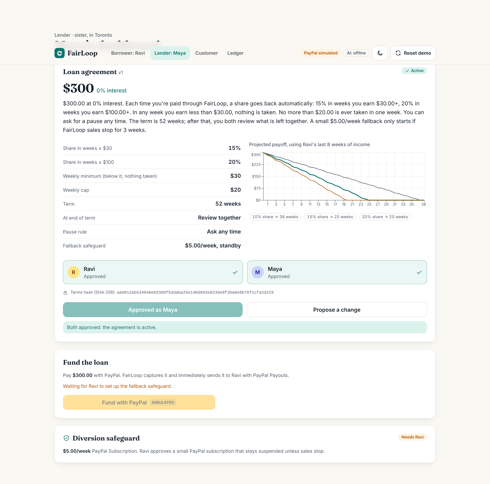
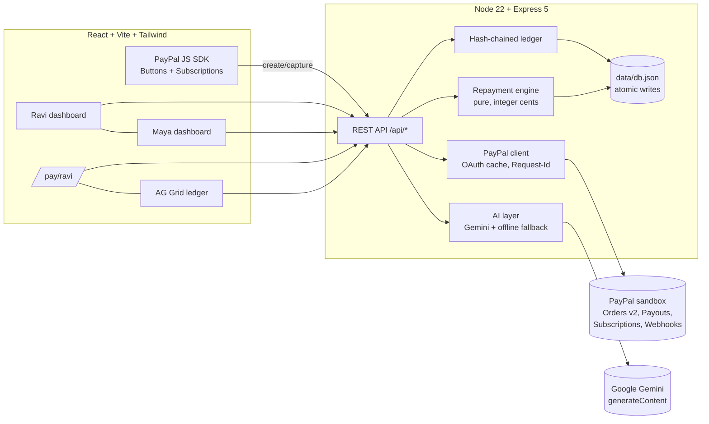

# FairLoop

**Interest-free loans between people who trust each other, repaid automatically from what the borrower earns, through PayPal.**



> Built for the PayPal AI Hackathon. This is a **demo with persona switching** (Maya the lender, Ravi the borrower, and a customer). There is no real authentication.

## The problem

People with small, irregular incomes (home bakers, tailors, tutors, delivery riders, freelancers) can't get fair credit. They go to moneylenders, or they borrow from family and friends, and that often damages the relationship: awkward reminders, missed payments, unclear terms. Fixed weekly payments don't fit irregular income either. One bad week and they default.

## The solution

A lender (family member, friend, community group or seller platform) and a borrower agree on a loan and a repayment rule tied to income. The borrower's customers pay through FairLoop's PayPal checkout. Each time the borrower earns, an agreed share goes to the lender automatically until the loan is repaid.

- **0% interest.** These are community and family loans. Commercial lending would need a licence (see "What's next").
- **AI drafts, people decide.** Gemini drafts a plain-language agreement, checks affordability against real income history, turns hardship messages into structured requests, and explains every deduction.
- **The money rules live in code.** A deterministic, unit-tested engine decides every cent. The AI never moves money.
- **USD only.** PayPal doesn't support domestic payments within India, so the demo uses international personas.

## Demo flow

1. **Ravi asks for a loan** in plain language: *"I need $300 for a new oven, I earn about $40–120 a week from cake orders."* If the amount is missing, the AI asks one follow-up question.
2. **The AI drafts the agreement**: amount, sliding share tiers, weekly minimum, weekly cap, pause rule, term and end-of-term action. A chart projects payoff from Ravi's seeded 8-week income history. If payoff would take more than 52 weeks, it shows a warning and suggests a smaller amount.
3. **Both people approve.** The agreement only becomes active once both click Approve. Either person can propose a change, and any change resets both approvals. A SHA-256 hash of the terms is stored with each approval.
4. **Diversion safeguard.** Ravi approves a small PayPal Subscription ($5/week by default), and FairLoop suspends it straight away. See below.
5. **Maya funds the loan** with PayPal Buttons (Orders v2: create, approve, capture on the server). FairLoop then disburses to Ravi with **PayPal Payouts**.
6. **A customer buys a cake** on `/pay/ravi`. After capture, the engine splits the payment and sends **one payout batch with two items**: Maya's share (`<capture>-LENDER`) and Ravi's remainder (`<capture>-BORROWER`).
7. **Low-income week.** "Simulate a week" (demo only, clearly labelled) adds small payments. If the week's total is below the minimum, nothing is taken, and the ledger shows *"Skipped: below weekly minimum"*.
8. **Hardship.** Ravi types *"I was sick this week, can I pause for 2 weeks?"* The AI turns this into a structured request. Maya approves or declines. Terms can never get harsher automatically.
9. **Paid off.** The last deduction is capped at the remaining balance, deductions stop, the fallback subscription is cancelled, and both dashboards show "Loan repaid 🎉".
10. **Ledger.** An AG Grid table lists every event, linked in a SHA-256 hash chain, with a **Verify chain** button.

### Diversion safeguard (fallback subscription)

If Ravi stopped routing sales through FairLoop, Maya would never get repaid. To prevent that:

- When the agreement is signed, FairLoop creates a plan (`POST /v1/catalogs/products`, then `POST /v1/billing/plans`). Ravi approves it with the JS SDK (`createSubscription`), and FairLoop immediately calls `POST /v1/billing/subscriptions/{id}/suspend`.
- **The engine decides** (`fallbackDecision` in `server/lib/engine.js`). If FairLoop income is **$0 for 3 consecutive weeks**, or **under 25% of declared weekly income for 3 weeks**, and there is no active hardship pause, both people are notified with an AI-written check-in message and FairLoop calls `/activate`.
- As soon as income returns, FairLoop calls `/suspend` again. On payoff it calls `/cancel`.
- Weeks covered by a hardship pause never count toward the trigger.

## Quick start (under 5 steps)

```bash
git clone https://github.com/vineeta07/PaypalAIHackathon.git
```

```bash
cd PaypalAIHackathon
```

```bash
npm install && npm start
```

Then open http://localhost:3000.

With no keys, the app runs in **simulated mode**: the same engine and API, fake `SIM-` ids, and a visible "PayPal simulated" badge. `npm start` builds the web app first if `dist/` is missing. To rebuild explicitly, run `npm run build && npm start`.

To use the real PayPal sandbox and Gemini, copy `.env.example` to `.env`, fill in the keys, and restart.

### Scripts

| Script | What it does |
|---|---|
| `npm run dev` | API with `--watch` on :3000 plus the Vite dev server on :5173 (proxies `/api`) |
| `npm run build` | Builds the React app into `dist/` |
| `npm start` | Serves the API and `dist/` (builds first if needed) |
| `npm test` | `node:test`: engine, PayPal client with mocked fetch, HTTP routes |
| `npm run lint` | TypeScript type-check plus a server syntax check |
| `npm run e2e` | Headless Chromium click-through of the whole demo; writes screenshots to `docs/screenshots/` (needs Playwright installed) |

## Sandbox test credentials / account setup

1. Go to https://developer.paypal.com/dashboard/, open **Apps & Credentials** (Sandbox) and create an app. Copy its **Client ID** and **Secret** into `PAYPAL_CLIENT_ID` and `PAYPAL_CLIENT_SECRET`.
2. In the app's settings, **enable Payouts** (under Features). Subscriptions are on by default; check they are enabled too.
3. Under **Sandbox → Accounts**, create 3 **personal** accounts: lender, borrower and customer. Put the lender and borrower emails in `.env` as `LENDER_PAYPAL_EMAIL` and `BORROWER_PAYPAL_EMAIL`. Log in to the PayPal popup with the lender account to fund the loan, and with the customer account to buy a cake.
4. Make sure the sandbox **business** account that owns the app has a USD balance, because Payouts are sent from it.
5. Optional: create a webhook pointing to `https://<your-host>/api/paypal/webhook` for `PAYMENT.CAPTURE.COMPLETED` and `PAYMENT.PAYOUTS-ITEM.*`, then set `PAYPAL_WEBHOOK_ID`.

> No test credentials are committed. Judges can run everything in simulated mode with zero keys.

## Environment variables

| Name | Required | Default | Purpose |
|---|---|---|---|
| `PAYPAL_CLIENT_ID` | no | (empty → simulated) | Sandbox REST app client id; also loads the JS SDK |
| `PAYPAL_CLIENT_SECRET` | no | (empty → simulated) | Sandbox REST app secret (server only) |
| `PAYPAL_API_BASE` | no | `https://api-m.sandbox.paypal.com` | PayPal REST base URL |
| `PAYPAL_WEBHOOK_ID` | no | (empty → webhook ignored) | Turns on webhook signature verification |
| `LENDER_PAYPAL_EMAIL` | with keys | `maya.lender@example.com` | Payout receiver for repayments |
| `BORROWER_PAYPAL_EMAIL` | with keys | `ravi.baker@example.com` | Payout receiver for disbursement and earnings |
| `GEMINI_API_KEY` | no | (empty → offline AI) | Google Gemini API key |
| `GEMINI_MODEL` | no | `gemini-3.6-flash` | Gemini model id |
| `PORT` | no | `3000` | HTTP port |
| `DATA_FILE` | no | `data/db.json` | JSON store location |

## Deploy to Render

The repo includes a `render.yaml` Blueprint. In Render, choose **New → Blueprint** and pick this repo. It builds with `npm ci --include=dev && npm run build`, starts with `npm start`, and health-checks `/api/health`. Secrets are declared `sync: false`, so Render asks for them. With no secrets it runs in simulated mode.

## Architecture



```
server/
  index.js          wires env → PayPal (sandbox or simulated), AI, store, app
  app.js            routes + orchestration (settle payment → engine → payout batch → ledger)
  seed.js           personas, products, 8-week income history
  lib/engine.js     repayment rule engine (no I/O, fully unit-tested)
  lib/paypal.js     PayPal REST client + simulated twin with the same interface
  lib/ai.js         Gemini function calling / responseSchema + deterministic fallbacks
  lib/ledger.js     SHA-256 hash chain
  lib/store.js      JSON store, atomic write via tmp + rename
web/src/            React app (pages: Borrower, Lender, Pay, Ledger)
test/               node:test suites
scripts/            start (build-if-missing), dev, e2e
```

## API

| Method | Path | Purpose |
|---|---|---|
| GET | `/api/health` | Health check (`paypal` and `ai` mode) |
| GET | `/api/state` | Everything the UI needs |
| POST | `/api/reset` | Reseed the demo |
| POST | `/api/loan/request` | `{text}` → AI plan → draft agreement |
| POST | `/api/agreement/approve` | `{role}` lender / borrower |
| POST | `/api/agreement/edit` | `{role, changes}`; resets both approvals |
| POST | `/api/fallback/plan` | Create the fallback subscription plan |
| POST | `/api/fallback/approved` | `{subscription_id}`; suspends it immediately |
| POST | `/api/fund/order` | Orders v2 create for the principal |
| POST | `/api/fund/capture` | `{order_id}`: capture, then Payouts disbursement |
| POST | `/api/pay/order` | `{product_id}`: Orders v2 create for a customer |
| POST | `/api/pay/capture` | `{order_id}`: capture, engine split, payout batch |
| POST | `/api/simulate/week` | `{mode: low/normal/good/zero}` (demo only) |
| POST | `/api/hardship/request` | `{text}` → AI structured request |
| POST | `/api/hardship/:id/decide` | `{role:"lender", approve}` |
| POST | `/api/review/approve` | `{role, option}`; applied only when both pick the same option |
| POST | `/api/payouts/:id/refresh` | Poll `GET /v1/payments/payouts/{id}` |
| GET | `/api/ledger`, `/api/ledger/verify` | Events and chain verification |
| POST | `/api/ai/explain` | `{capture_id}` → plain-language explanation |
| POST | `/api/paypal/webhook` | Verified webhook (only when `PAYPAL_WEBHOOK_ID` is set) |

## How PayPal is used

- **OAuth2 client credentials** with a cached token (refreshed 60 seconds before expiry).
- **Orders v2**: `POST /v2/checkout/orders` (intent `CAPTURE`, items plus `amount.breakdown`, `custom_id` linking to the loan or product), then `POST /v2/checkout/orders/{id}/capture`. The capture id is read from `purchase_units[0].payments.captures[0]`, and it is the idempotency key for the repayment engine.
- **Payouts**: `POST /v1/payments/payouts` with a unique `sender_batch_id` (`FL-<capture id>`, also used as the `PayPal-Request-Id`, so retries are idempotent). Each item has a clear `sender_item_id`. The UI polls `GET /v1/payments/payouts/{id}` and shows item statuses (PENDING → SUCCESS / UNCLAIMED / FAILED).
- **Subscriptions**: catalog product, billing plan, buyer approval through the SDK, then `suspend` / `activate` / `cancel` driven by the engine.
- **JS SDK**: Buttons for Orders (`onApprove` calls the server to capture, and `INSTRUMENT_DECLINED` calls `actions.restart()`), plus a second namespaced SDK instance (`vault=true&intent=subscription`) for the fallback.
- A `PayPal-Request-Id` is sent on every POST. Error responses show PayPal's `name`, `details[0].issue` and `debug_id` in human-readable messages.
- **Webhooks**: `POST /v1/notifications/verify-webhook-signature` runs before any event is accepted.

**Production path, honestly:** in this hackathon build, FairLoop's sandbox business account briefly holds the funds and redistributes them with Payouts. In production this would use **PayPal Multiparty / Commerce Platform**, so the platform never holds the funds: the borrower would be the merchant of record, with the lender's share handled as a platform-directed split.

## How AI is used

Gemini is called over REST (`generateContent`, `x-goog-api-key` header):

| Function | Technique | Output, validated in code |
|---|---|---|
| `analyze_affordability` | **Function calling.** The model proposes candidate terms, and our code runs the projection on real income history and returns payoff weeks | Payoff weeks per scenario |
| `draft_agreement` | Function call args, which follow a typed schema | Terms are clamped: share 0–30%, minimum ≥ 0, term 4–104 weeks. Every clamp shows a visible note |
| `parse_hardship_request` | `responseSchema` structured JSON | One of pause / reduce share / extend term / fixed amount / partial forgiveness |
| `explain_deduction` | Structured JSON | A friendly explanation that uses only the engine's numbers |
| `suggest_review_options` | Structured JSON | 3 gentler options for the 4-low-week review |
| check-in message | Structured JSON | Warm message sent when the fallback activates |

Every function has a **deterministic offline fallback** (regex parsing plus templates), used when there is no key or Gemini returns an error. The header badge shows **AI: Gemini** or **AI: offline**.

## Safety: where the line is drawn

- **The AI only proposes.** It cannot approve, move money, or change an active loan. Humans approve; the engine enforces.
- **User text is treated as data.** It is quoted inside delimiters, and the system prompt tells the model to ignore any instructions inside it. Whatever the model returns is validated and clamped anyway, so a successful prompt injection can at most produce a draft that a human still has to approve.
- **Integer cents everywhere.** Shares are basis points, rounded down so the borrower is never over-charged.
- **Idempotency.** Payments are keyed by capture id, payout batches by `sender_batch_id`, and fallback charges by week.
- **Never harsher automatically.** `isHarsher()` checks every dimension (share, cap, minimum, term, fallback, end-of-term action). A harsher change needs the borrower's approval, and the `reduce_share` hardship option can only lower shares.
- **Both approvals are bound to the terms hash.** Any edit resets both approvals.
- **Tamper evidence.** The ledger is a SHA-256 hash chain with one-click verification.
- **No secrets in the repo.** `.env` is git-ignored, and `.env.example` is provided.

## Repayment rules (engine)

- Weekly income is the sum of the borrower's captured payments in that ISO week. The tier is chosen from the week's total so far, *including* the current payment.
- Deduction = share × payment, capped by the remaining weekly cap and by the remaining balance.
- Nothing is taken while the loan is paused or while the week's total is below the minimum. When a later payment lifts the week over the minimum, deductions start **from that payment onward**; earlier payments are never charged retroactively. *(Interpretation note: the payment that crosses the minimum is deducted.)*
- 4 consecutive low weeks open a review. Nothing changes until both people pick the same option.
- At the end of the term, `end_of_term_action` applies: `review` or `forgive_remaining`.
- Every decision returns a reason, for example: *"15% of $40.00 = $6.00 → $6.00 to Maya. Week total $85.00, normal tier."*

## Tests

```bash
npm test
```

23 `node:test` tests cover: tiers, the weekly minimum crossing mid-week, the weekly cap, the final payment capped at the balance, pause, the 4-week review trigger, idempotency, the both-approvals requirement, edits resetting approvals, AI-output clamping, hardship that cannot increase the borrower's burden, end of term, fallback activation/suspension/cancellation (including pause and the 25% rule), the PayPal client against a mocked fetch (token caching, request ids, capture parsing, error parsing, payout batch building), and a full HTTP flow from request to payoff.

`npm run e2e` drives the whole demo in headless Chromium. It fails on any console error or horizontal overflow at 360, 390, 768, 1024 and 1440 px, in light and dark mode.

## Limitations

- Persona switching instead of authentication. It's a single shared demo state.
- The JSON file store suits a demo, not concurrent production traffic. On Render's free plan the disk is ephemeral, so state resets on redeploy.
- "Simulate a week" uses simulated captures even in sandbox mode, to avoid spamming real sandbox payouts. It is labelled "Demo only".
- In sandbox mode, real fallback subscription charges arrive at the platform account. Forwarding them to the lender would need a `PAYMENT.SALE.COMPLETED` webhook handler; this is implemented only in simulated mode.
- The real PayPal sandbox and Gemini paths are unit-tested against mocked responses, but they need your keys to verify live.

## What's next

- PayPal Multiparty / Commerce Platform onboarding so funds never touch the platform.
- Real accounts and auth, plus invitations by email or link.
- Hindi and Spanish agreements (language toggle).
- Group lending circles, and seller-platform lenders.
- Licensed partners for commercial (interest-bearing) lending, where regulation allows.

## License

[MIT](LICENSE) © 2026 Vineeta
